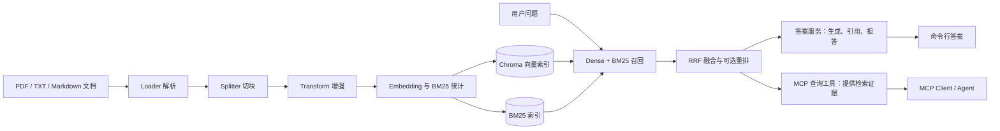

# 售后客服 RAG 问答系统

运行下列示例需要本地准备 `data/` 中的文档与索引；该目录按 `.gitignore` 不随源码发布。评测题集与结果报告保存在仓库中。

## 项目结构

```text
MODULAR-RAG-MCP-SERVER-main/
├── config/                 # 模型配置与 Prompt
├── data/                   # 本地文档、向量索引和 BM25 索引
├── scripts/                # 摄取、查询、回答、评测和 Dashboard 入口
├── src/
│   ├── core/               # 数据类型、检索、回答和 Trace
│   ├── ingestion/          # 文档摄取流水线
│   ├── libs/               # Loader、Splitter、Embedding、存储等组件
│   ├── mcp_server/         # MCP 服务与工具
│   └── observability/      # 日志、评测和 Dashboard
├── tests/                  # 单元、集成、端到端测试及评测题集
├── reports/                # 评测结果
├── DEV_SPEC.md             # 开发设计规格
└── README.md               # 项目说明
```

## 整体流程



答案服务和 MCP 查询工具是不同入口：前者生成最终回答，后者把检索证据提供给外部客户端。

## 第一环节：文档提取

### 完成什么任务

从指定文件或目录发现受支持的文档，提取正文与来源信息，并转换为统一的 `Document`，供后续切块和建索引使用。

### 如何设计

`scripts/ingest.py` 接收文件路径和 collection，发现 PDF、TXT、Markdown 文件。正式摄取由 `src/ingestion/pipeline.py` 编排：先检查文件是否已处理，再按扩展名选择 Loader。`TextLoader` 读取 UTF-8 文本，`PdfLoader` 使用 MarkItDown 提取 PDF 内容；两者遵循 `BaseLoader` 接口，输出统一的 `Document`，包含正文和来源元数据。加载阶段会记录 Trace，便于查看解析结果和耗时。
使用 LangChain 的 `RecursiveCharacterTextSplitter` 进行切分。

### 有什么优点

- **统一输入**：切块模块只处理 `Document`，不需要关心原文件格式。
- **可追溯**：保留来源路径和内容哈希，方便核对原文与避免重复处理。
- **易排查**：文档发现、解析和后续索引是不同阶段，发生问题时能缩小范围。

### 运行命令

在项目根目录的 PowerShell 中，使用已配置的 `.venv` 和本地 `config/settings.yaml`：

```powershell
.\.venv\Scripts\python.exe scripts/ingest.py --path data/documents/jd_after_sales --collection jd_after_sales --dry-run
```


```powershell
.\.venv\Scripts\python.exe scripts/ingest.py --path data/documents/jd_after_sales --collection jd_after_sales
```

## 第二环节：混合检索与重排

### 完成什么任务

根据用户问题，从已有索引中召回相关的文档 Chunk，融合不同检索方式的候选结果，并按相关性排序，为后续答案生成或外部工具调用提供证据。

### 如何设计

`scripts/query.py` 组装查询组件。`HybridSearch` 对问题做预处理，再使用 Dense 向量检索和 BM25 关键词检索召回候选；`RRFFusion` 根据两路排名融合结果，不直接比较两种原始分数。启用重排时，Reranker 对融合后的候选再次排序。`--verbose` 展示各阶段结果，便于检查证据在哪一步出现及排名如何变化。

### 有什么优点

- **召回方式互补**：Dense 处理语义相近的表述，BM25 关注问题中的明确词项。
- **分数尺度无关**：RRF 用排名融合，不要求向量相似度和 BM25 分数处于同一尺度。
- **结果可检查**：中间候选与来源路径可见，可以判断是否找齐跨文档证据；重排只调整已召回候选，不能补回完全漏召的证据。

### 运行命令与本次结果

```powershell
.\.venv\Scripts\python.exe scripts/query.py --query "PLUS会员自营商品因自己误购退货，寄回运费和原订单已收运费分别怎么处理？" --collection jd_after_sales --top-k 5 --verbose
```

本次现场运行中，Chroma 报告该 collection 有 **46 条记录**。Dense、BM25、RRF 融合和重排后的结果均包含两篇所需资料；最终 Top 5 中，[自营售后运费说明](https://help.jd.com/user/issue/131-496.html) 排第 1，[退货后原运费返还](https://help.jd.com/user/issue/109-193.html) 排第 2。前者说明 PLUS 会员因自身原因退货的返回运费，后者说明非质量问题退货时原订单已收运费的返还规则。

## 第三环节：基于证据生成答案

### 完成什么任务

把检索到的相关 Chunk 转化为面向用户的回答，并附上可追溯的资料引用；当没有检索结果或证据不足时，返回明确的拒答状态。

### 如何设计

`scripts/answer.py` 组装检索器、重排器和 LLM，调用 `RAGAnswerService`。服务先召回候选并重排到指定的 Top K，再为每个 Chunk 编号，将问题与编号证据交给模型。模型按要求基于证据回答并在结论后标注 `[1]` 等编号。程序核对引用编号是否指向本次检索结果，只展示回答实际使用的来源；检索、重排或生成发生异常时返回错误状态，避免把系统故障当作知识不足。

### 有什么优点

- **答案有依据**：回答中的引用可定位到本次检索的原始 Chunk，便于人工核对。
- **职责清楚**：检索与重排负责找资料，LLM 负责组织回答，程序负责校验引用编号和组织响应。
- **结果可诊断**：区分 `answered`、`refused` 和 `error`，并展示模型、Token 用量及重排相关度等运行信息。

程序校验引用编号对应本次检索结果；演示中结合原文核对回答结论。

### 运行命令与本次结果

```powershell
.\.venv\Scripts\python.exe scripts/answer.py --query "PLUS会员自营商品因自己误购退货，寄回运费和原订单已收运费分别怎么处理？" --collection jd_after_sales --top-k 5
```

本次运行返回 `status=answered`，使用 `qwen3.6-flash`，最高重排相关度为 `0.7337`，报告总计 `3600` Token。回答分别引用[自营售后运费说明](https://help.jd.com/user/issue/131-496.html)与[退货后原运费返还](https://help.jd.com/user/issue/109-193.html)，区分了退货寄回运费和原订单已收运费。两项结论可在对应原文中找到依据；寄回垫付运费的余额返还标准另有中国大陆收货地址的适用范围，演示时应结合原文说明。

## 第四环节：资料不足时拒答

### 完成什么任务

当检索证据不足以支撑可靠回答时，返回明确的拒答结果，避免仅凭弱相关片段生成看似确定的答案。

### 如何设计

`RAGAnswerService` 对空检索结果直接拒答。启用 `--min-rerank-score` 时，服务将最终候选中的最高重排分数与指定门槛比较；若低于门槛，就在构造模型上下文之前返回 `refused`，并记录 `low_rerank_relevance`。如果已经进入生成阶段，模型仍可用 `INSUFFICIENT_EVIDENCE` 表示资料不足，由服务转成统一拒答响应。检索、重排或模型调用异常则返回 `error`，不视为资料不足。

### 有什么优点

- **降低无依据回答**：弱相关检索结果不会直接进入答案生成。
- **节省生成调用**：被分数门槛拦截时，不调用答案 LLM。
- **便于排查**：`stop_reason` 区分低相关度、空结果、模型判断证据不足和系统错误。

重排分数表示模型对候选相关性的判断。门槛可结合可回答与不可回答的对照题进行评估。

### 运行命令与本次结果

```powershell
.\.venv\Scripts\python.exe scripts/answer.py --query "今天天气怎么样？" --collection jd_after_sales --top-k 5 --min-rerank-score 0.6
```

本次现场运行返回 `status=refused`、`stop_reason=low_rerank_relevance`。最高重排相关度为 `0.2757`，低于本次指定的 `0.6000`，因此在答案生成前拒答。

## 第五环节：MCP 连接与工具发现

### 完成什么任务

让外部 MCP Client 连接知识库服务，完成协议初始化，并获得可调用工具的名称、用途和参数定义。

### 如何设计

`src/mcp_server/server.py` 以 stdio 方式运行 MCP Server，`src/mcp_server/protocol_handler.py` 注册工具并响应工具列表请求。Client 先发送 `initialize`，收到 Server 信息与能力声明后发送 `notifications/initialized`，再用 `tools/list` 获取工具的 `name`、`description` 和 `inputSchema`。客户端可据此确定工具用途与调用参数。

### 有什么优点

- **能力可发现**：客户端连接后可读取工具清单及参数结构。
- **协议统一**：外部客户端通过 MCP 消息与服务交互，无需了解检索器的内部类和函数。
- **职责分明**：工具发现只确认接口可见，实际知识库查询需要随后执行 `tools/call`。

### 运行命令与本次结果

```powershell
.\.venv\Scripts\python.exe -m pytest tests/e2e/test_mcp_client.py::TestMCPClientE2E::test_initialize_and_tools_list -v
```

本次现场运行收集 1 项测试并通过。测试启动真实 MCP Server，核对初始化响应与工具列表，并确认能发现 `query_knowledge_hub`、`list_collections`、`get_document_summary`，且各工具提供输入参数 Schema。

## 第六环节：MCP 工具调用协议验证

### 完成什么任务

验证外部 MCP Client 能向知识检索工具提交参数，并收到符合 MCP 规范的工具响应。

### 如何设计

Client 在初始化后发送 `tools/call`，指定 `query_knowledge_hub` 及查询参数。MCP Server 按工具名分发请求，工具封装检索流程，再将执行结果封装为 `CallToolResult` 的内容块。本环节的端到端测试检查协议响应结构。

### 有什么优点

- **调用接口统一**：客户端使用工具名和参数调用能力，无需直接依赖项目内部的 Python 检索类。
- **链路可验证**：测试覆盖 Client 消息、Server 分发和工具响应的协议往返。
- **结果格式统一**：客户端通过 MCP 内容块接收工具响应。

### 运行命令与本次结果

```powershell
.\.venv\Scripts\python.exe -m pytest tests/e2e/test_mcp_client.py::TestMCPClientE2E::test_tools_call_query_knowledge_hub -v
```

本次现场运行收集 1 项测试并通过。测试通过 MCP Client 调用 `query_knowledge_hub`，并检查返回的 `CallToolResult` 包含合法的 `content` 内容块，验证了工具调用的协议往返。

## 第七环节：评测流程预览

### 完成什么任务

展示项目如何组织多题评测：先核对评测题集，再比较检索与重排结果，最后检查可回答和不可回答问题的拒答表现。

### 如何设计

`scripts/evaluate_jd_full.py` 统一编排四个步骤：`check_retrieval`、`check_refusal`、`retrieval_and_rerank` 和 `refusal`。前两步调用 `scripts/evaluate_jd_after_sales.py --mode check` 核对题集；后两步分别运行检索排序评测和拒答评测。检索题集、拒答题集和 `RRF k=60` 由编排脚本固定，便于使用同一配置比较结果。`--dry-run` 打印步骤及参数，供演示时检查运行计划。

### 有什么优点

- **流程集中**：一条命令展示题集核对、检索排序与拒答评测的执行顺序。
- **参数可见**：题集路径、RRF 参数和报告路径直接出现在预览输出中。
- **便于复现**：正式运行使用同一脚本和参数生成各阶段报告及汇总。

### 运行命令与本次结果

```powershell
.\.venv\Scripts\python.exe scripts/evaluate_jd_full.py --dry-run
```

本次现场运行依次打印了四个步骤及对应命令，并以 `Dry run complete. No API calls or reports were written.` 结束，确认评测编排的运行计划可正常展示。

## 第八环节：评测报告与指标解读

### 完成什么任务

用多题评测报告比较各检索路线的证据召回与排序，并检查系统对可回答、不可回答问题的响应状态。

### 如何设计

评测脚本在同一题集上比较 Dense、BM25、RRF、RRF + Rerank 的 Top 5。`hit_at_5` 按预期来源文档统计，`chunk_hit_at_5` 按预期证据 Chunk 统计；`mrr_at_5` 根据首个命中结果的排名计算平均倒数。对需要多份证据的题，`all_required_chunks_at_5` 检查全部必需 Chunk 是否进入 Top 5。拒答评测分别统计不可回答题的拒答率和可回答对照题的误拒答率。结果保存在 `reports/jd_after_sales_full_pilot.json`。

### 有什么优点

- **同题比较**：四条检索路线使用同一批问题与证据标注，便于比较召回和排序变化。
- **兼顾单条与多条证据**：同时检查是否命中任一正确 Chunk，以及多证据问题是否找齐必需 Chunk。
- **同时观察拒答两面**：记录不可回答题的拒答表现，也记录可回答题被拒答的比例。

### 查看命令与已有报告结果

```powershell
$r = Get-Content -Raw -Encoding utf8 reports/jd_after_sales_full_pilot.json | ConvertFrom-Json
$r.retrieval.summary | ConvertTo-Json -Depth 3
$r.refusal | ConvertTo-Json
```

评测报告中，50 道检索题的证据 Chunk Hit@5：Dense 为 `46/50`，BM25 为 `44/50`，RRF 为 `46/50`，RRF + Rerank 为 `49/50`；对应 Chunk MRR@5 分别为 `0.895`、`0.8267`、`0.8667`、`0.9567`。16 道需要多份证据的题中，RRF 找齐全部必需 Chunk 为 `14/16`，重排后为 `15/16`。拒答评测中，10 道不可回答题均返回拒答，6 道可回答对照题均未被拒答。

## Bad Case 分析：通用换货规则未进入 Top 5

### 情况

评测中的 `s13` 问题是“自营商品收到八天后发现质量故障，还在换货期限内吗？”。标注证据来自[质量问题处理](https://help.jd.com/user/issue/118-453.html)：商品有质量问题时支持 7 天退货、15 天内换货。正确 Chunk 在 Dense 候选中排第 10、BM25 候选中排第 18；按报告候选与 `RRF k=60` 计算，融合后排第 9，进入重排候选，但最终没有进入 Top 5。最终结果主要是食品、电脑等品类售后细则，其中也有“15 天内换货”等相近条款。

这暴露了当前检索排序的一个不足：当问题未指定商品品类时，通用规则与多个品类细则竞争排名，标注的通用证据可能被挤出最终结果。

### 可能原因

- 多篇品类细则重复出现“质量问题”“7 天”“15 天”“换货”等词，Dense 和 BM25 都把这些相近片段排在通用规则前面。
- RRF 按两路候选的名次融合，不识别“通用规则”和“特定品类规则”的适用范围；正确 Chunk 虽进入重排候选，初始位置仍靠后。
- 重排可能更看重时限词与问题的表面匹配，未充分区分未指定品类的问题与品类细则。以上是待验证的解释，逐题报告本身只证明排名变化。

### 后续改进计划

1. 对照 `s13` 的证据标注与最终 Top 5 原文，确定哪些片段能独立支持回答、哪些只适用于特定品类。
2. 查看这一题的重排分数与候选正文，定位通用规则在重排阶段的具体名次和分数差距。
3. 在确认问题后，尝试将规则适用范围纳入检索或重排：未指定品类时优先考虑通用规则，明确品类时优先考虑对应细则。一次只改变一个因素，在同一题集上比较 `s13` 正确证据排名、整体 Chunk Hit@5、多证据题找齐率及额外耗时，再决定是否采用。

## 第九环节：Trace 与 Dashboard

### 完成什么任务

记录查询链路的中间结果和阶段耗时，并通过可视化页面查看一次问题从预处理、召回、融合到重排的执行过程，辅助定位检索与回答问题。

### 如何设计

查询入口将问题、collection、调用来源和各阶段数据写入 Trace；`TraceCollector` 持久化记录。Streamlit Dashboard 的 `Query Traces` 页面读取查询历史，提供关键词筛选、Dense/Sparse 结果数量、阶段耗时和检索阶段详情。答案服务的 Trace 还记录上下文构造、答案生成、引用校验或相关度门槛等步骤。

### 有什么优点

- **过程可追溯**：从同一次查询的 Trace 对照输入、来源及各阶段结果。
- **定位更具体**：结合候选数量、排序详情和耗时判断问题发生在哪个处理阶段。
- **入口一致**：命令行答案和 MCP 工具调用都可以记录查询 Trace，便于按来源检查调用链路。

### 运行命令与本次结果

```powershell
.\.venv\Scripts\python.exe scripts/start_dashboard.py --port 8502
```

在 `http://localhost:8502` 打开 Dashboard，进入 `Query Traces` 查看查询记录。
